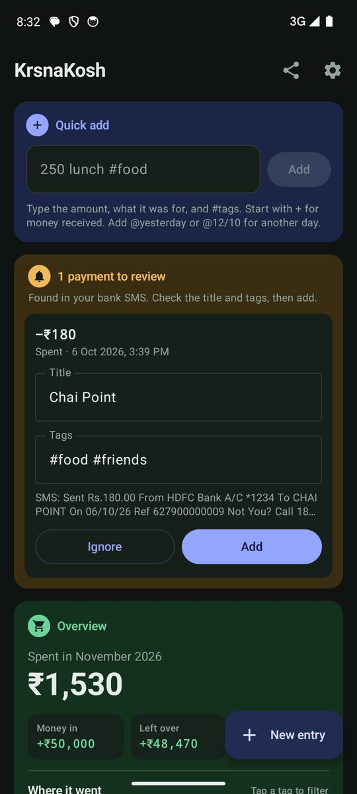
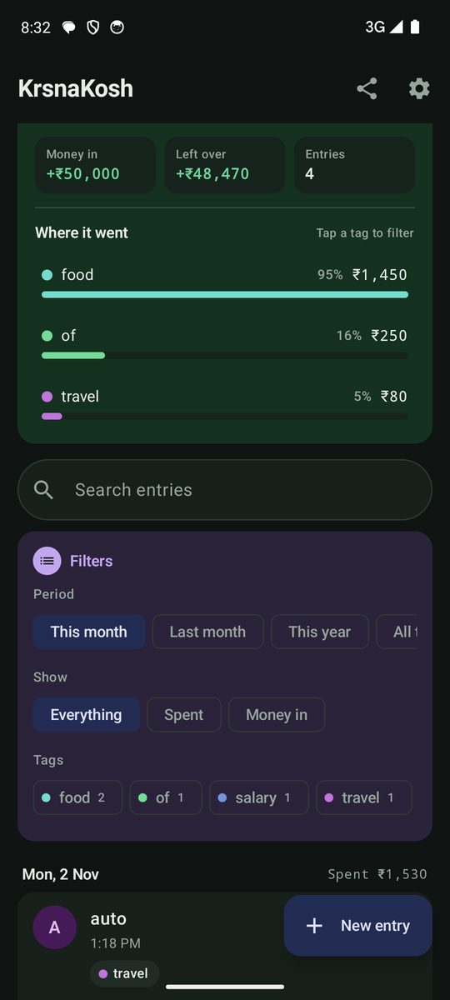
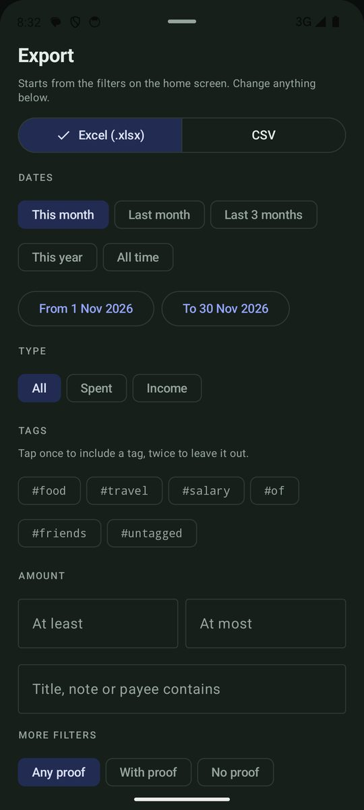

# KrsnaKosh

<p><a href="https://github.com/shivam1234-hub/krsnakosh/releases/latest/download/KrsnaKosh.apk"><b>⬇️ Download APK</b></a> · <a href="https://github.com/shivam1234-hub/krsnakosh/releases/latest">all versions</a><br><sub>Android: open the downloaded file and tap Install. You may need to allow installs from your browser first.</sub></p>

## Screenshots

<table><tr><td align="center"><br><sub>Home</sub></td><td align="center"><br><sub>Overview</sub></td><td align="center"><br><sub>Export</sub></td></tr></table>


A personal expense ledger for Android. It picks up UPI payments by itself, lets you tag and organise them, and keeps a live copy in your own Google Sheet. (In the code the app is still called Tag Ledger, its first name.)

## Features

- **Bank SMS to entries:** every UPI debit or credit SMS becomes a notification and a "payment to review". Once you've tagged a payee, later payments to them arrive with the same title and tags.
- **Google Pay receipts:** share a payment from Google Pay to the app. It reads the amount, payee, time and UPI reference on the phone, keeps the screenshot as proof, and opens a new entry.
- **No duplicates:** payments are matched by UPI reference, so an SMS and a shared receipt for the same payment are added only once.
- **Tags, notes and proof photos** on every entry. You can attach a bill photo to an older entry too.
- **Look back 30 days:** pull in recent payments from SMS already on the phone.
- **Google Sheet and Drive sync (optional):** every save goes to an Expenses tab in your own Sheet, and proof photos go to a Drive folder. This uses a small Apps Script ([`apps-script/Code.gs`](apps-script/Code.gs)) protected by your own secret.
- **Export** to Excel or CSV, filtered by:
  - dates, spent or income, and tags (include or exclude)
  - amount and text
  - proof photo and source
  - sort order and columns
  
  Excel exports also get Summary, By tag and By month sheets.
- **Private:** no account and no server. SMS and receipts are read on the phone.
- **Web version:** `index.html` is the same ledger for a laptop browser.

## Building
```bash
cd android
./gradlew testDebugUnitTest assembleRelease   # needs Android Studio's JDK and SDK
```
Kotlin, Jetpack Compose, ML Kit on-device text recognition.
